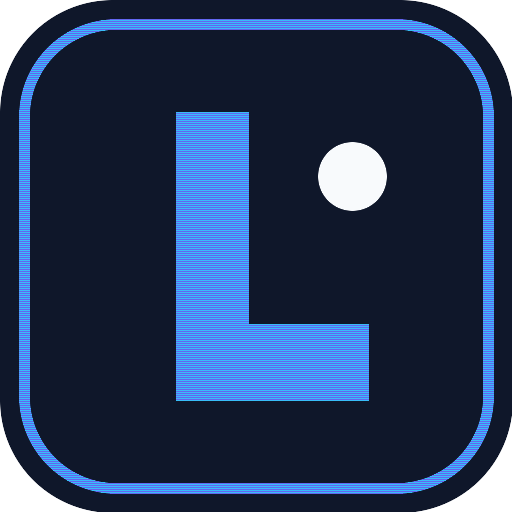

# Lazem Browser (متصفح لازم)

A desktop web browser built with Electron. Version 0.1, first testable version. Made by Hazem (HazemYT55).

**Edition folder: `Lazem_Compelete`.** All three edition folders (Lazem_Compelete, Lazem_Build, Lazem_Test) currently hold the same shared core. Edition-specific differences are not defined yet, see `EDITION.md`.

> **Logo status:** the logo here is a proposed placeholder, not approved branding.

## What works (tested on Linux only)
- Tabs (Ctrl+T new, Ctrl+W close, Ctrl+L address bar), back, forward, reload, home
- Address bar that takes a URL or a search, with a search engine picker: Google, DuckDuckGo, Brave, Bing, Yahoo
- Bookmarks (star button)
- Built-in ad blocking from this project's own code: `blocklist.txt` (about 40 ad domains, add your own lines) plus hiding common ad boxes. It blocks common ads only, not all ads.
- New-tab page with shortcut tiles: drag a tile onto the middle of another to make a folder, drag to the edge to reorder, add and remove tiles, rename folders
- Background color or image URL, settings saved between runs
- Safety: web pages get no permissions (camera, mic, location), only http/https pages open from the address bar

## Not built yet
VPN, custom extension language, offline mode, Lazem Search, lazem domains, publishing, installer (.exe), tab restore on restart.

## Not tested
Windows and Mac (only Linux was tested). Sites like YouTube, Google and Scratch were not tested in depth. YouTube video ads are not blocked.

## Run it
1. Install Node.js (nodejs.org).
2. In this folder run: `npm install` then `npm start` (on Windows you can double-click `run-windows.bat`).

See `README-AR.txt` for Arabic instructions.
