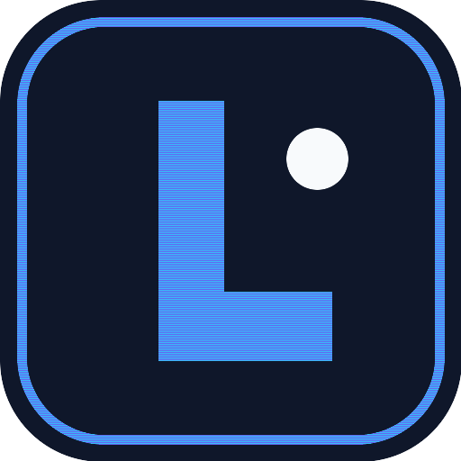

# Lazem-Browser

Hazem's Lazem Browser project (متصفح لازم): a desktop browser built with Electron.

Three edition folders, named by Hazem:
- `Lazem_Compelete`
- `Lazem_Build`
- `Lazem_Test`

Right now all three contain the same shared core (v0.1). Edition-specific differences are not defined yet. Each folder has its own README.md and EDITION.md. The logo is a proposed placeholder, not approved branding.
